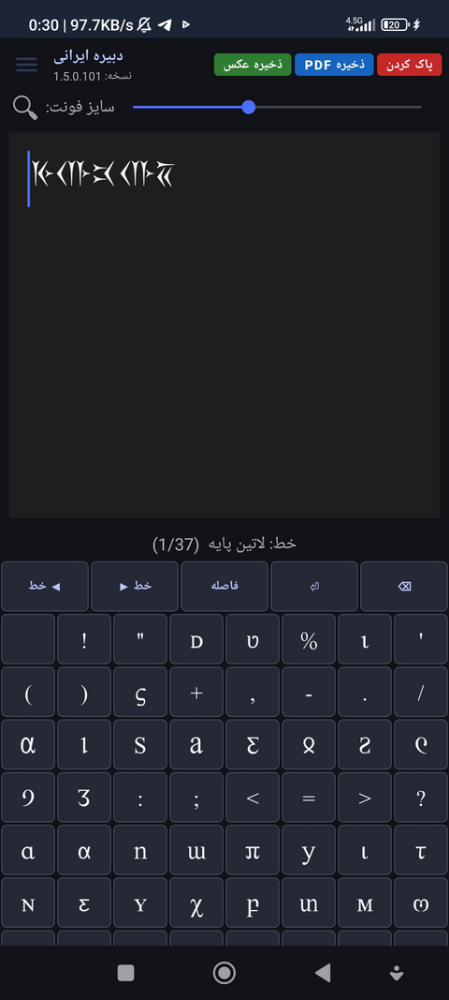
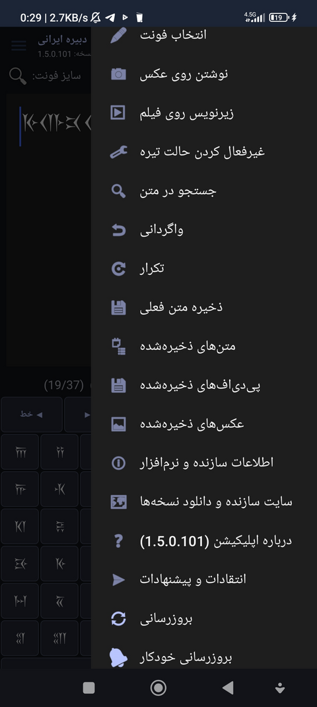
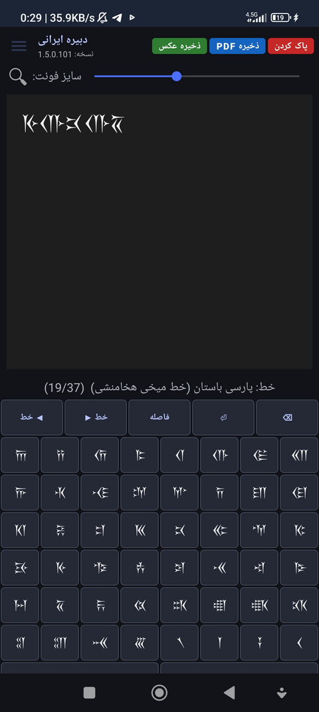
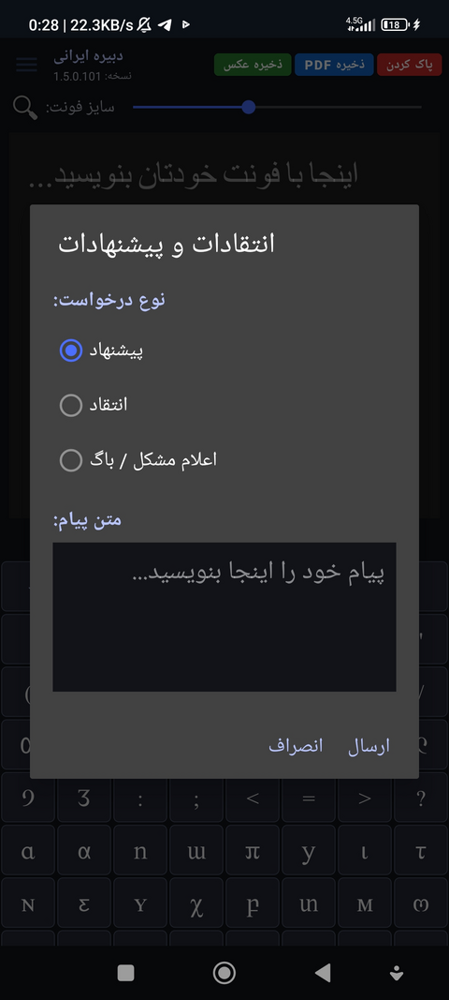
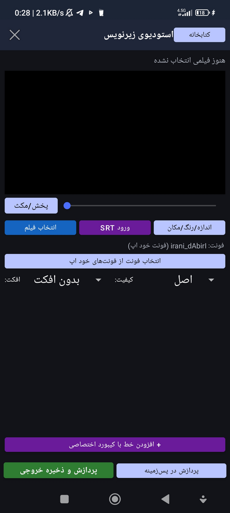

# دبیره ایرانی

کیبورد و واژه‌پرداز دبیره‌های کهن ایرانی، با پشتیبانی از خط میخی پارسی باستان، پهلوی، اوستایی، مانوی و ده‌ها دبیره دیگر.

---

## 📸 تصاویر اپلیکیشن

  
  
  
  
  

---

## 📥 دانلود

**نسخه فعلی: `2.3.45.311`**

### [⬇️ دانلود مستقیم APK](https://github.com/ssanssak-hub/Ancient-Iranian-script-download-/releases/latest/download/dabire_irani_iranian_script.apk)

برای مشاهده سایر نسخه‌ها به [صفحه Releases](https://github.com/ssanssak-hub/Ancient-Iranian-script-download-/releases) مراجعه کنید.

---

## 🆕 تغییرات آخرین نسخه

### تغییرات نسبت به نسخه 2.1.10.296
### ✨ ویژگی‌های جدید
- 🔔 افزودن شدن چندین قلم جدید متحرک و ثابت و چندین طرح آماده برای پس زمینه های آماده در طراحی آزاد
- 👥 افزوده شدن قابلیت انتشار / آپلود / حذف / دانلود دیکشنری از و در مخزن اپلیکیشن
- 🔄 افزودن شدن چندین کاراکتر کمتر شناخته شده خط پهلوی کتابی/ هام دبیره
- 🪄 افزودن شدن قابلیت قلم سه بعدی متحرک با بیش از ۱۰۰ قلم متحرک ۳ بعدی و قابلیت استفاده در تم اپلیکیشن
- ✨ افزوده شدن آیدی اختصاصی برای هر دیکشنری تولید شده برای حفاظت و اعمال copyright ©️
- 🎉 افزوده شدن گزینه PDF برای دانلود جدول دبیره ها بصورت PDF
- 📚 افزوه شدن کتابخانه و با قابلیت دانلود از مخزن اپلیکیشن یا سایت های دیگر و آپلود از گوشی
- 👑 افزوده شدن ترجمه زنده و آنلاین از طریق اینترنت یا دیکشنری های موجود در اپلیکیشن
- ✒️ اضافه شدن گزینه ترجمه آنلاین برای فارسی و انگلیسی
- 🗯️ پیشنهاد واژه در هنگام نوشتن واژگان
- 📜 افزوده شدن جستجو با عکس کتیبه ها
### 🐛 باگ
- 🔄 رفع باگ ماندن واژه خط در حالت آیکونی میانبر ها
- 🦠 رفع باگ مشکل لمس ۳ ثانیه ای و ارتقا به ۵ ثانیه ای آیکون یا متن میانبر ها برای تغییر حالت خودکار
- 🎬 رفع باگ های ساختاری و اعمال کنترل ۱ مگابایتی برای حجم وویس برای افزودن به تلفظ واژگان در دیکشنری ها
- 🎲 رفع باگ عدم اعمال تنظیمات منو اصلی متحرک و ثابت بر کیبورد اپلیکیشن و کادر های های متن در صفحه اصلی اپلیکشین و تبدیل متن به دبیره های آزاد
- 🗑️ رفع باگ در حذف و اضافه دیکشنری به مخزن اپلیکیشن
### 🔧 بهبودها
- ✅ بهبود تنظیمات منو و اعمال تنظیمات بر برخی دکمه ها
- 🕹️ افزایش تعداد میانبر های کاربردی و افزوده شدن 🪄 به دکمه های اصلی صفحه اصلی اپلیکشین
- 💥 تنظیم دقیق و اعمال تنظیم تغییر خودکار در برخی حروف هام دبیره
- 🎆 بهبود های جزئی در آیتم تنظیم آهنگ و افزایش تعداد افکت ها

---

## ✨ ویژگی‌ها

- پشتیبانی از ده‌ها دبیره کهن ایرانی
- کیبورد اختصاصی با فونت انتخابی
- زیرنویس‌گذاری روی فیلم
- نوشتن روی عکس
- خروجی PDF و تصویر
- حالت تیره
- رابط کاربری کاملاً فارسی

---

## 📱 نصب

1. فایل APK را دانلود کنید
2. در تنظیمات گوشی، اجازه نصب از **منابع ناشناس** را فعال کنید
3. روی فایل APK بزنید و نصب کنید

> **نکته:** این اپلیکیشن خارج از Google Play توزیع می‌شود، بنابراین اندروید ممکن است هشدار «منبع ناشناس» نمایش دهد. این کاملاً طبیعی است.

**نیازمندی:** اندروید ۷ (API 24) یا بالاتر

---

## 📢 ارتباط با ما

- 📣 کانال تلگرام: [@dabireirani](https://t.me/dabireirani)
- 🐛 گزارش باگ: [Issues](https://github.com/ssanssak-hub/Persian-font-keyboard-/issues)

---

## 🔒 امنیت و شفافیت

- ✅ کاملاً **رایگان** و **بدون تبلیغ**
- ✅ **بدون دسترسی به اطلاعات شخصی** شما
- ✅ کد منبع به‌صورت شفاف توسعه داده می‌شود
- ✅ تغییرات هر نسخه در [صفحه Releases](https://github.com/ssanssak-hub/Ancient-Iranian-script-download-/releases) قابل مشاهده است

---

**آخرین به‌روزرسانی: 2026-10-25** • **ساخته شده با ❤️**

